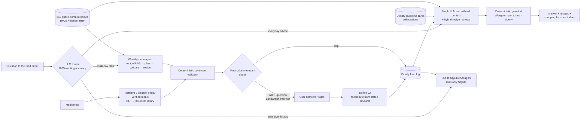

# 食贴 Meal Sticker · AI Family Meal Agent

An AI backend for **Meal Sticker (食贴)**, a meal-journal app that logs meals from a photo and acts as a family food butler for you, your elderly parents and your pets.

What sets the project apart is that **every AI technique was A/B-tested before it shipped**. Each change was benchmarked on a public dataset with paired-bootstrap 95% confidence intervals and kept only if it measurably helped. Several popular techniques did not help, and the write-up below says why.

| | Original app | Shipped | Change |
|---|---|---|---|
| Nutrition error (macro wMAPE, JFB, 200 photos) | 28.7% | **23.8%** | **−17%** (95% CI −8.2 to −1.7 pts) |
| Ingredient recognition F1 | 0.566 | **0.648** | **+14%** (95% CI +0.048 to +0.122) |
| Questions over 4 months of meal history answered exactly (30 questions) | 23% (full log in prompt) | **100%** (Text-to-SQL agent) | 11× cheaper |
| Weekly menus satisfying all 7 constraints (12 scenarios) | 0% (one-shot) | **100%** (RAG + verify-and-revise agent) | |
| Whole system, 90 mixed requests | 58% (always single call) | **97%** (LLM router) | 36% cheaper and 37% faster than always-agent |

iOS app: [meal-sticker-ios](https://github.com/takagisa111-tech/meal-sticker-ios)

---

## Architecture



**Tech stack:** Python, FastAPI, SQLite, LangGraph (ReAct agents, state graphs, human-in-the-loop interrupt/resume, checkpointing), LLM routing, Text-to-SQL, DeepSeek vision LLM (OpenAI-compatible API, JSON mode, function calling), sentence-transformers (CLIP ViT-B/32, multilingual MPNet), BM25 + dense hybrid retrieval with Reciprocal Rank Fusion, MCP server, NumPy/SciPy evaluation with paired bootstrap.

---

## 1. Meal recognition

**Benchmark:** [January Food Benchmark](https://github.com/January-ai/food-scan-benchmarks), a set of real-world meal photos with human-validated meal names, ingredients and macros (CC-BY-4.0). The test set is a fixed random 200 photos (seed 42). The other 800 photos serve only as the retrieval library, so test and library never overlap. Metrics follow JFB: macro wMAPE, ingredient P/R/F1 with Hungarian matching, and a weighted composite score. All differences are paired against the original app prompt, with 2,000-sample bootstrap 95% CIs.

| # | Method | wMAPE ↓ | Δ vs original (95% CI) | Ingredient F1 ↑ | Latency | Cost / photo |
|---|---|---|---|---|---|---|
| 0 | **Original app prompt** (Chinese) | 28.7% | — | 0.566 | 1.6 s | $0.0006 |
| 1 | English prompt v2 (checklist, portion references, JSON mode) | 33.8% | +5.2 (+1.3, +9.0) ❌ | 0.540 | 2.2 s | $0.0009 |
| 2 | English prompt v3 (calibrated) | 29.2% | +0.6 (−3.5, +4.5) | 0.435 | 2.0 s | $0.0008 |
| 3 | v3 + nutrient-table RAG (USDA FNDDS, hybrid retrieval, LLM rerank) | 31.2% | +2.5 (−1.6, +6.5) | 0.443 | 2.9 s | $0.0012 |
| 4 | **Chinese prompt v2** (same techniques, app's language) | 25.7% | −3.0 (−5.6, −0.4) ✅ | 0.587 | 2.0 s | $0.0009 |
| 5 | Chinese v2 + nutrient-table RAG | 26.7% | −2.0 (−4.7, +0.8) | 0.590 | 2.9 s | $0.0014 |
| 6 | Self-consistency (original prompt × 3, averaged) | 26.9% | −1.8 (−3.4, −0.3) | 0.537 | 1.6 s | $0.0017 |
| 7 | Chinese v2 + **multimodal RAG**, 3 refs, text only | 25.5% | −3.2 (−6.4, −0.2) ✅ | 0.625 | 2.2 s | $0.0010 |
| 8 | Chinese v2 + multimodal RAG, 3 refs, image + text | 25.6% | −3.1 (−6.5, +0.1) | 0.626 | 2.4 s | $0.0013 |
| 9 | **Chinese v2 + multimodal RAG, 5 refs** | 24.6% | −4.1 (−7.0, −1.3) ✅ | 0.629 | 2.4 s | $0.0016 |
| 10 | Agent (LangGraph), no questions | 25.0% | −3.6 (−6.8, −0.6) | 0.590 | 3.1 s | $0.0016 |
| 11 | Agent, ask only when unsure (≤2), refine v1 | 25.0% | −3.7 (−7.0, −0.5) | 0.620 | 5.1 s | $0.0025 |
| 12 | **Agent, ask 1 question + refine v2** (shipped) | **23.8%** | **−4.9 (−8.2, −1.7)** ✅ | **0.648** | 5.8 s | $0.0030 |
| 13 | Agent, ask only when unsure (≤2) + refine v2 | 26.4% | −2.3 (−6.3, +1.9) | 0.630 | 6.1 s | $0.0028 |

In the agent rows, questions are answered by a **simulated user**: an LLM that knows the ground-truth dishes and amounts but not the nutrition numbers, and replies the way a normal person would ("one glass of milk plus half a cup of ice cream").

### What we learned

- **Language was confounded with technique.** The first round of English prompts looked like a big win on ingredient scores. The reason was that cross-lingual name matching penalized the Chinese baseline. Once names were normalized before scoring, the English prompts turned out *worse*: they over-estimated by +50 to +83 kcal per meal, while the Chinese baseline under-estimated by −39. Porting the same techniques back into Chinese (row 4) produced the first real gain.
- **RAG works when it targets the actual bottleneck.** Looking up "kcal per 100 g" in a nutrient database (rows 3 and 5) did not help, because error analysis showed the main error comes from portion size, not energy density. Retrieving *visually similar meals with verified portions* as in-context references (rows 7–9) attacks portion size directly. It cut error by 14% and raised ingredient F1 by 11%.
- **Text references work as well as image references** (rows 7 vs 8). The model benefits from the verified amounts and ingredients of similar meals more than from comparing the pictures, so the text-only version is a cheaper option.
- **Asking the user helps only if the answer is actually used.** With refine v1, the model often kept its old estimate even after the user gave exact amounts (soup stayed at 230 kcal after "I finished the whole bowl"). Refine v2 forces a recomputation from the stated quantities using standard household conversions, and became the best configuration (row 12).
- **"Ask only when unsure" did not beat "always ask one question"** (row 13 vs 12). The difference sits within noise, and always asking one question is simpler for the user, so that is what shipped. The user can always skip.

---

## 2. The family food butler: a router plus three specialised paths

Different questions need different architectures, so a cheap LLM call first **routes** each request and then dispatches it. Each path was benchmarked against a simpler alternative.

### 2a. Everyday advice → single call + retrieval (an agent was the wrong tool here)

**Tasks:** "What should I cook for lunch with what's in my fridge? Add missing items to my shopping list", "How did my 82-year-old mom eat this week? Remind me at 7 am to cook her breakfast", "Pick a restaurant under ¥60 and two dishes", "Can my cat eat grapes, apples, onions, pumpkin?", plus **adversarial requests** (a user with a peanut allergy asking for Kung Pao chicken, or feeding a dog onion omelette).

**Benchmark:** 48 reproducible scenarios: adults with allergies, 80+ elders, cats and dogs, 7-day logs with designed nutrient gaps, a fridge and restaurants. Every check is decided by code:
- **safety:** no allergens, pet toxins, or hard-to-chew food for elders
- **gap:** the plan fills the designed nutrient gap
- **fridge:** uses fridge items when asked
- **shopping:** adds to the list only when asked, only items not in the fridge
- **reminder:** creates reminders only when asked
- **restaurant:** recommends real restaurants and dishes
- **cite:** cites real guideline cards
- **pet:** detects toxic foods without false alarms

| Variant | Task success | Recommends real recipes | Latency | Cost / task |
|---|---|---|---|---|
| ReAct agent (LangGraph, 9 tools) + guardrail | 79% | — | 8.1 s | $0.0053 |
| ReAct agent, no guardrail | 90% | — | 7.0 s | $0.0053 |
| Single call with full context | 100% | no (invents dishes) | 2.1 s | $0.0012 |
| **Single call + hybrid recipe retrieval + guardrail** (shipped) | 94% | **100%** | 2.4 s | $0.0016 |

All variants held on the adversarial requests. At family scale the context is only a few thousand tokens, so one call sees everything at once. The ReAct agent added failure points, about 3× the latency and 4× the cost. Recipe retrieval was kept because it grounds every home-cooking suggestion in a real recipe with per-serving calories, at the cost of three extra misses on the nutrient-gap check.

### 2b. Questions over months of history → Text-to-SQL agent

**Tasks:** "How many meals with fish did I have in the last 30 days?", "When did I last have hot pot?", "On average, do I eat more on weekends or weekdays?", "Has my takeout gone up over the last 4 weeks?", "How many days last month did mom have no dairy?"

**Benchmark:** 120 days of synthetic family meal logs (823 rows in SQLite, with planted patterns) and 30 questions. Every reference answer comes from a hand-written SQL query. Counts and dates must match exactly; averages must fall within 5%.

| Variant | Exact accuracy | Counting questions | Input tokens | Cost / question | Latency |
|---|---|---|---|---|---|
| Whole log in the prompt (single call) | 23% | 6% | 29,000 | $0.0129 | 1.4 s |
| **Text-to-SQL ReAct agent** (read-only, single SELECT) | **100%** | **100%** | 2,000 | **$0.0011** | 1.7 s |

LLMs cannot reliably count or average across hundreds of rows. Writing SQL turns that into exact computation, and it is 11× cheaper because the model reads the schema, not the data.

### 2c. Multi-day planning with many constraints → RAG + verify-and-revise agent

**Task:** plan 7 dinners satisfying 7 hard constraints at once:
- all dishes are real recipes, no repeats
- every dinner is within a calorie range
- at least 2 fish dinners and at least 4 with vegetables
- no allergens (plus no fried or hard food for elders)
- days 1–2 each use something from the fridge
- weekday dishes have difficulty ≤ 3★

Each plan is checked by a deterministic validator. 12 scenarios; every one has at least one valid solution.

| Variant | Plans passing every constraint | Avg violations | LLM calls | Latency | Cost |
|---|---|---|---|---|---|
| One-shot (all ~280 recipes in the prompt) | 0% | 3.7 | 1 | 1.4 s | $0.0053 |
| One-shot + validator feedback, ≤2 revisions | 50% | 1.6 | 3 | 3.9 s | $0.0163 |
| **ReAct agent: recipe RAG + `validate_plan` tool** | **100%** | **0** | 5.3 | 7.2 s | $0.0154 |

The verify-and-revise loop alone takes the pass rate from 0% to 50%. Letting the agent run targeted searches (fish dishes, soft dishes, dishes using the fridge spinach) and validate its own drafts takes it to 100%, at the same cost.

### 2d. Routing: the whole system

90 mixed requests (48 everyday, 30 history, 12 weekly-plan). A misrouted request counts as a failure.

| Strategy | Success | Cost / request | Latency |
|---|---|---|---|
| Always single call | 58% | $0.0059 | 1.9 s |
| Always agent | 94% | $0.0053 | 5.3 s |
| **LLM router → best path** (shipped) | **97%** | **$0.0034** | **3.3 s** |

The router classified all 90 requests correctly. Routing beat both fixed strategies on accuracy, and it is 36% cheaper and 37% faster than always using agents.

---

## Knowledge sources

| Source | Used for | License |
|---|---|---|
| January Food Benchmark | evaluation + verified-meal retrieval library | CC-BY-4.0 |
| USDA FNDDS 2021–2023 | nutrient-table RAG experiments | Public domain (CC0) |
| [HowToCook](https://github.com/Anduin2017/HowToCook) | recipe retrieval (362 recipes with per-serving amounts) | Unlicense |
| Dietary Guidelines for Chinese Residents (2022), elderly guidelines, ASPCA / AVMA pet-toxin lists | guideline cards (paraphrased summaries, each with a source link) | cited, not redistributed verbatim |

## Run it

```bash
./setup.sh                      # venv + dependencies
cp .env.example .env            # add your DeepSeek API key (never committed)
.venv/bin/python -m uvicorn app.server:app --port 8000   # web app at http://localhost:8000
.venv/bin/python mcp_server.py  # MCP server (stdio) for Claude Desktop and other MCP clients

# reproduce the evaluation
.venv/bin/python -m evals.run_eval --pipeline agent_always1_r2 --dataset jfb --n 200
.venv/bin/python -m evals.planning --variant plain_rag
.venv/bin/python -m evals.analytics --variant agent
.venv/bin/python -m evals.weekly --variant agent
.venv/bin/python -m evals.routing
.venv/bin/python -m evals.report jfb 200
```

## Repository layout

```
mealagent/
  prompts/        every prompt version that was evaluated (v2, v3, zh, mm, agent, planner)
  pipelines/      each experiment as a function, for ablations
  agent/          LangGraph agents: recognizer (HITL), planner, analyst (Text-to-SQL), weekly (verify loop), router, guardrail rules
  data/           120-day SQLite meal history generator
  rag/            FNDDS hybrid index, CLIP visual index, generic Chinese-friendly hybrid index
  knowledge/      guideline cards with citations, recipe loader
evals/            datasets, metrics, simulated user, planning scenarios, reports with bootstrap CIs
app/              FastAPI server + web UI (human-in-the-loop question flow)
mcp_server.py     MCP tools: recognize_meal, ask_meal_butler, check_food_safety, search_recipes, search_guidelines
results/          summary JSON and reports for every run
```

## Limitations

- JFB photos are mostly Western meals with human-validated (not weighed) labels. A Chinese-meal test set is the next step.
- The question-answering results rely on a simulated user. Real users answer less precisely.
- Planning scenarios and the meal history are synthetic, so the checks measure correctness and rule compliance, not taste.
- The LLM runs at temperature > 0, so reruns move by roughly ±1 point. This is why every claim above comes with a confidence interval.
